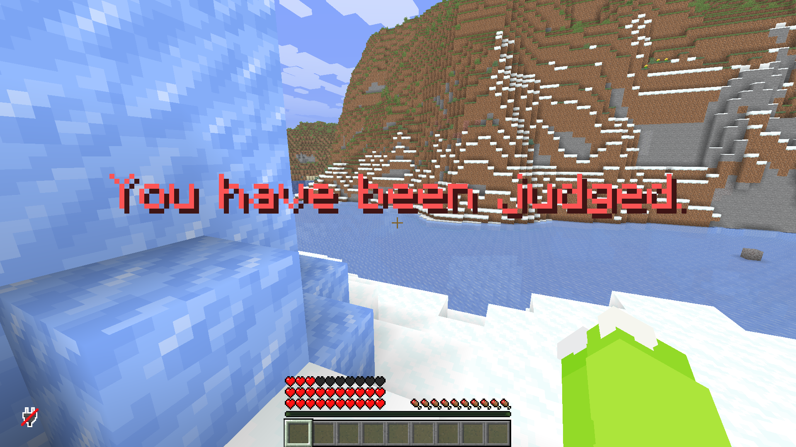
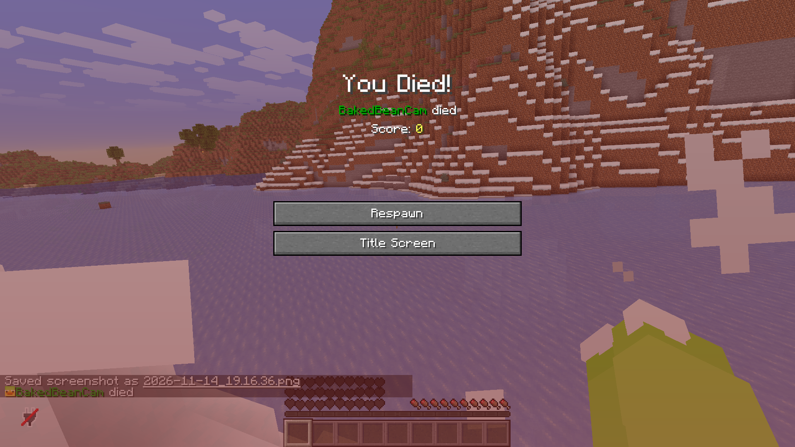
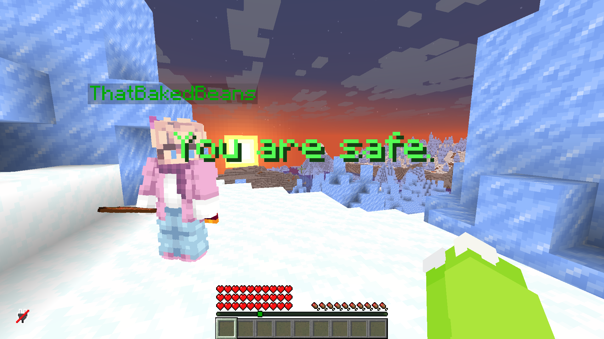
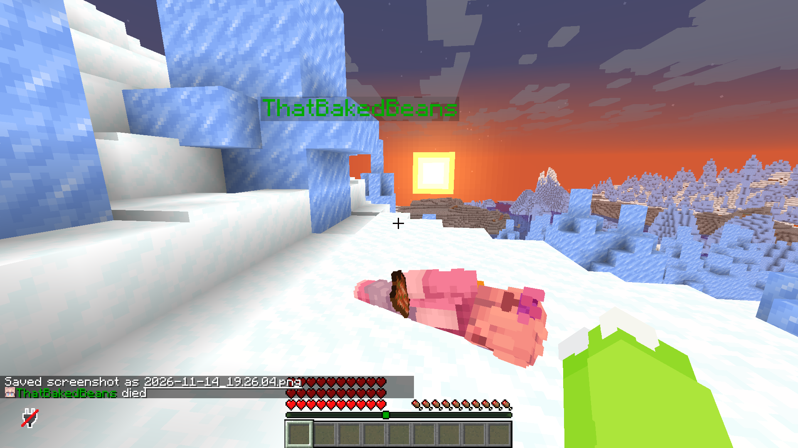

# Vital Verdict
Vital Verdict is a Life Series-inspired Minecraft plugin.

# Object of the Game
All players start with a green life (starts at 6 lives by default). Every time you die, you lose a life. As you lose lives, you will go down to a light green name, then yellow, then red. Yellow names can kill green names, and red names can kill anyone. You can reverse any illegal kills with `/vv set <player> <lives>`.
Natural regeneration is turned off, so the only way to regenerate is through Golden Apples, Suspicious Stew, Potions, etc.

Every player also has a boosted max health (60 HP or 30 hearts by default).

There is a timer with a set interval (30 minutes by default). Every time the timer elapses, the player with the lowest current health is immediately killed.

Once you lose your last life, you are put into spectator.

# Starting the Game
To start the game, run `/vv start`. This will reset everything and set up gamerules and attributes.

To stop the game, run `/vv stop`. Do not use this as a pause function. The best way to pause is to stop the server.

